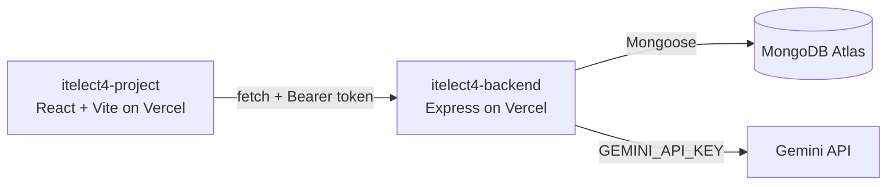

# itelect4-backend

[](https://github.com/KennethCyrilPimentel/itelect4-backend/actions/workflows/ci.yml)

REST API for **Shoot Tracker**, a photography booking app where clients request shoots, track their status and follow editing batches (deliverables). Built with Node, Express, TypeScript, MongoDB (Mongoose) and JWT authentication. One route sends a shoot description to Google's Gemini and returns a structured review (summary, shot list, prep tips, difficulty).

## Live links

- **Live backend (API):** https://itelect4-backend-eta.vercel.app
- **Live frontend:** https://itelect4-project-it-4-b-mu.vercel.app
- **Frontend repo:** https://github.com/KennethCyrilPimentel/itelect4-project-IT4B

Health check: https://itelect4-backend-eta.vercel.app/api/health

## Architecture



## Routes

Every route except register, login and health needs the header `Authorization: Bearer <token>`. Each user only sees their own rows.

| Method | Route | Description |
|---|---|---|
| GET | `/api/health` | Server and database status |
| POST | `/api/auth/register` | Create an account |
| POST | `/api/auth/login` | Log in, returns `{ token, user }` |
| GET | `/api/shoots` | List my shoots |
| GET | `/api/shoots/:id` | One shoot |
| POST | `/api/shoots` | Create a shoot |
| PATCH | `/api/shoots/:id` | Update a shoot |
| DELETE | `/api/shoots/:id` | Delete a shoot |
| GET | `/api/deliverables` | List my deliverables (`?shootId=` filters by shoot) |
| GET | `/api/deliverables/:id` | One deliverable |
| POST | `/api/deliverables` | Create a deliverable on one of my shoots |
| PATCH | `/api/deliverables/:id` | Update a deliverable |
| DELETE | `/api/deliverables/:id` | Delete a deliverable |
| POST | `/api/ai` | AI review of a shoot description (limited to 5 requests a minute per account) |

## Run it locally

```
npm install
npm run dev
```

Create a `.env` file with:

```
MONGODB_URI=your MongoDB Atlas connection string
JWT_SECRET=any long random string
CLIENT_URL=http://localhost:5173
GEMINI_API_KEY=your Gemini API key
```

The API runs on http://localhost:4000. Other scripts: `npm run build`, `npm run typecheck` and `npm test`.

## Tests and CI

`npm test` runs Vitest with Supertest against the real Express app, with the database connection replaced and Gemini never called. The tests check that `POST /api/ai` answers 401 with no token and with a forged token, and that a valid token gets past the auth check.

GitHub Actions (`.github/workflows/ci.yml`) runs the type check and the tests on every push. `JWT_SECRET` is stored as a GitHub repository secret.

## Deployment

Deployed on Vercel. `MONGODB_URI`, `JWT_SECRET`, `CLIENT_URL` (the frontend's address, used for CORS) and `GEMINI_API_KEY` are set as environment variables there.

## AI-use disclosure

I used Claude (Anthropic) as a coding assistant while building this project: explaining concepts, helping debug errors, and suggesting code that I then ran, tested and adapted to my own app. The Shoot Tracker app is also an AI feature itself: the `/api/ai` route calls Google's Gemini and validates its reply with a schema before returning it.